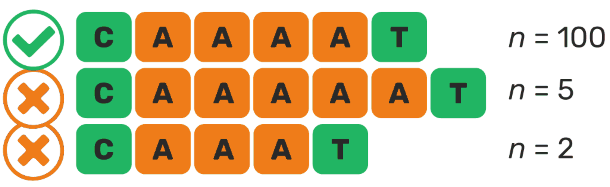

# Parameters

Set parameters on the command line with two dashes (`--its_region full`) or collect them in a
[parameter file](usage.md#parameter-files) passed with `-params-file`.
To print the description of a parameter from the pipeline itself, use `--help <parameter>`.

Each section below follows the order of the pipeline. A dash (–) in the Default column means the parameter is not set by default.

## General

| Parameter | Default | Description |
| --- | --- | --- |
| `--step` | `Step1` | Part of the pipeline to run: `Step1`, `Step2` or `seqstats` |
| `--outdir` | `results` | Output directory |
| `--tracedir` | `<outdir>/pipeline_info` | Directory for execution reports |
| `--storagemode` | `rellink` | How results are placed in `--outdir` ^1^ |
| `--gzip_compression` | `7` | GZIP compression level of output files, `1` (fastest) to `9` (smallest) |
| `--max_cpus` | `80` | Upper limit of CPUs for a single task ^2^ |
| `--max_memory` | `132.GB` | Upper limit of memory for a single task ^2^ |
| `--max_time` | `240.h` | Upper limit of run time for a single task ^2^ |
| `--validate_params` | `true` | Check parameter values before the run starts |
| `--monochrome_logs` | `false` | Disable coloured terminal output |
| `--help` | – | Show help; `--help <parameter>` shows help for one parameter |
| `--helpFull` | `false` | Show help for all parameters |
| `--showHidden` | `false` | Include hidden parameters in the help |
| `--helpMsg` | `false` | Show the older plain-text help message |
| `--version` | `false` | Print the pipeline version and exit |

^1^: `rellink` creates relative links into the work directory, `symlink` absolute links, `link` hard links;
`copy` copies files and `move` moves them (`move` breaks `-resume`). With any link mode, results depend on the work directory;
see [Where results are stored](usage.md#where-results-are-stored).

^2^: Used by the `hpc_utslurm` profile to cap per-task resources. In your own configs, use Nextflow's
[`process.resourceLimits`](https://www.nextflow.io/docs/latest/reference/process.html#resourcelimits) instead (see [Running on HPC](HPC.md)).

## Step-1

### Input

| Parameter | Default | Description |
| --- | --- | --- |
| `--input` | – | Multiplexed reads as one FASTQ or BAM file, or a folder of per-sample FASTQ files (with `--demultiplexed true`) |
| `--barcodes` | – | FASTA file with sample barcodes. Required for multiplexed input. |
| `--demultiplexed` | `false` | Set to `true` if `--input` is a folder of per-sample files |
| `--seqplatform` | `PacBio` | Sequencing platform: `PacBio` or `Illumina` |

See [Input data](usage.md#input-data) for formats and naming rules.

### Quality filtering

| Parameter | Default | Description |
| --- | --- | --- |
| `--qc_maxee` | – | Maximum number of expected errors per read |
| `--qc_maxeerate` | `0.01` | Maximum expected errors per base |
| `--qc_maxhomopolymerlen` | `25` | Remove reads with a homopolymer of this length or longer |
| `--qc_maxn` | `4` | Maximum number of ambiguous bases (`N`) per read |

Expected errors are computed from Phred scores ([Edgar & Flyvbjerg 2015](https://doi.org/10.1093/bioinformatics/btv401)).
The homopolymer filter targets technical artefacts only:
real fungal ITS often contains homopolymers longer than 10 bases ([Tedersoo et al. 2022](https://doi.org/10.1111/mec.16460)).

### Demultiplexing (PacBio)

Demultiplexing of PacBio reads is done with [lima](https://lima.how/).

| Parameter | Default | Description |
| --- | --- | --- |
| `--lima_barcodetype` | `dual_symmetric` | Barcoding scheme: `dual_symmetric`, `dual_asymmetric`, `dual` (mixed) or `single` |
| `--lima_minscore` | `93` | Minimum barcode score (0–100) ^1^ |
| `--lima_minendscore` | `50` | Minimum score of the second barcode (asymmetric and mixed schemes) |
| `--lima_minrefspan` | `0.75` | Minimum fraction of the barcode covered by the read |
| `--lima_minscoringregions` | `2` | Number of barcodes that must be found in dual schemes (`2` = both) |
| `--lima_windowsize` | `70` | Window at the read ends to search for barcodes, bp |
| `--lima_minlen` | `40` | Minimum read length after barcode removal |
| `--lima_remove_unknown` | `false` | Discard reads with barcode combinations not listed in `--barcodes`. If `false`, they are kept as separate samples named after the barcodes. |

^1^: The score measures how well a barcode aligns to the read. The default suits 12-bp barcodes;
lower it for shorter barcodes. See the [lima FAQ on barcode scores](https://lima.how/faq/barcode-score.html).

### Illumina paired-end (experimental)

!!! warning "Experimental"
    These parameters apply with `--seqplatform Illumina` and may change between releases.
    The `-profile miseq` and `-profile novaseq` presets set suitable QC and merging values.

| Parameter | Default | Description |
| --- | --- | --- |
| `--input_R1` | – | Multiplexed R1 reads (FASTQ.gz) |
| `--input_R2` | – | Multiplexed R2 reads (FASTQ.gz) |
| `--illumina_pe_pattern` | `*_R{1,2}*.{fastq,fq}.gz` | File pattern of per-sample read pairs in the `--input` folder (with `--demultiplexed true`) |
| `--illumina_barcodetype` | `dual_symmetric` | Tag layout: `dual_symmetric` (same tag on both reads), `dual_asymmetric` (different tags, `FWD...REV` format) or `single` |
| `--illumina_revtag_orient` | `auto` | Orientation of the reverse tag in the barcode file: `auto` (detected from the data), `forward` or `revcomp` |
| `--illumina_demux_rescue` | `false` | Rescue read pairs where only one tag can be read (only for tags used by a single sample) |
| `--barcode_window` | `30` | Search window for tags at the 5′ end of reads (`0` = tag must start the read) |
| `--barcode_errors` | `2` | Maximum mismatches in a tag |
| `--barcode_overlap` | `11` | Minimum overlap between read and tag |
| `--barcode_minlen` | `50` | Minimum read length after tag removal |
| `--pe_merger` | `usearch` | Tool for merging read pairs: `usearch` or `vsearch`. Use `vsearch` with the `vmikk/nextits:1.2.4` image, which does not include USEARCH. |
| `--pe_maxdiffs` | `10` | Maximum mismatches in the overlap |
| `--pe_pctid` | `80` | Minimum percent identity in the overlap |
| `--pe_minoverlap` | `16` | Minimum overlap length |
| `--pe_minlen` | `50` | Minimum length of a merged read |
| `--pe_maxlen` | – | Maximum length of a merged read |
| `--qc_polyglen` | `10` | Trim 3′ poly-G tails at least this long before merging (two-colour chemistry); `0` = no trimming |
| `--qc_binned` | – | Expected quality score type (binned or not). Set by the presets; used only to warn about a mismatch with the data. |
| `--illumina_keep_notmerged` | `false` | Join read pairs that can't be merged, with an `N` spacer. Requires `--its_region none` and `--hp false`. |
| `--illumina_joinpadgap` | `NNNNNNNNNN` | Spacer sequence for joined pairs |
| `--illumina_joinpadqual` | `IIIIIIIIII` | Quality string of the spacer |
| `--trim_minlen` | `10` | Minimum sequence length after primer trimming (applies to all platforms) |

### Primers

| Parameter | Default | Description |
| --- | --- | --- |
| `--primer_forward` | `TACACACCGCCCGTCG` | Forward primer, 5′ → 3′ (ITS9mun) |
| `--primer_reverse` | `CCTSCSCTTANTDATATGC` | Reverse primer, 5′ → 3′ (ITS4ngsUni) |
| `--primer_mismatches` | `2` | Maximum mismatches in a primer |
| `--primer_foverlap` | primer length − 2 | Minimum overlap with the forward primer |
| `--primer_roverlap` | primer length − 2 | Minimum overlap with the reverse primer |

See [Primers](usage.md#primers) for orientation rules and alternative primers.

### ITS extraction

| Parameter | Default | Description |
| --- | --- | --- |
| `--its_region` | `full` | Region to extract: `full`, `ITS1`, `ITS2`, `ITS1_5.8S_ITS2`, `SSU`, `LSU` or `none` |
| `--itsx_tool` | `ITSx` | Extraction tool: `ITSx` (v1.x, HMMER) or `ITSx2` (Infernal; faster, covers all eukaryotes) |
| `--ITSx_tax` | `all` | Taxonomic profiles to use (ITSx 1.x only) ^1^ |
| `--ITSx_evalue` | `0.1` | E-value cutoff (ITSx 1.x only) |
| `--ITSx_partial` | `0` | Keep partial sequences at least this long; `0` = off (ITSx 1.x only) |
| `--ITSx_complement` | `F` | Search both strands (`T`) or only the forward strand (`F`) (ITSx 1.x only) ^2^ |
| `--ITSx_heuristics` | `false` | Use HMM filtering heuristics (ITSx 1.x only) |
| `--ITSx_chunk_size` | `9999` | Unique sequences per extraction task; `0` = one task per sample |
| `--ITSx_to_parquet` | `true` | Collect the extracted regions of all samples into `03_ITSx_PooledParts/rRNA_parts.parquet`. Needed for `--rrna_parts` in Step-2. |

The conserved SSU and LSU flanks don't separate species, so random errors in them inflate the number of OTUs.
They are also where chimera breakpoints are hard to detect
([Lindahl et al. 2013](https://doi.org/10.1111/nph.12243), [Tedersoo et al. 2022](https://doi.org/10.1111/mec.16460)).
NextITS therefore extracts the ITS with ITSx ([Bengtsson-Palme et al. 2013](https://doi.org/10.1111/2041-210X.12073)) before clustering.

| `--its_region` | Result |
| --- | --- |
| `full` | Full-length ITS (ITS1–5.8S–ITS2) as detected by ITSx |
| `ITS1_5.8S_ITS2` | Full ITS assembled from the separately detected ITS1, 5.8S and ITS2. Use it when ITSx can't find the SSU end, e.g. with the ITS1catta primer. |
| `ITS1`, `ITS2` | One spacer only |
| `SSU`, `LSU` | The flanking 18S or 28S fragment |
| `none` | No extraction; primers are trimmed only |

^1^: A comma-separated list (no spaces) of lowercase group names, or `all` (e.g., `--ITSx_tax fungi` or `--ITSx_tax fungi,metazoa`).
Accepted names: `alveolata`, `amoebozoa`, `bacillariophyta`, `bryophyta`, `chlorophyta`, `euglenozoa`, `eustigmatophyceae`,
`fungi`, `haptophyceae`, `marchantiophyta`, `metazoa`, `oomycota`, `parabasalia`, `phaeophyceae`, `raphidophyceae`,
`rhizaria`, `rhodophyta`, `synurophyceae`, `tracheophyta`.

^2^: Reads are already oriented by the primers, so one strand is enough. If ITSx detects the ITS in few reads, try `T`.

### Long-chimera removal

| Parameter | Default | Description |
| --- | --- | --- |
| `--long_chimera` | `false` | Remove sequences with rRNA genes in both orientations (inverted chimeras) or repeated rRNA regions (e.g., two copies of 5.8S). Runs after primer trimming. |
| `--long_chimera_minbits` | `50` | Minimum bit score of an rRNA hit |
| `--long_chimera_mincov` | `0.4` | Minimum fraction of the rRNA model covered by a hit |

### Homopolymer correction

| Parameter | Default | Description |
| --- | --- | --- |
| `--hp` | `true` | Correct homopolymer errors |
| `--hp_similarity` | `0.999` | Similarity threshold for clustering homopolymer-compressed sequences (0.8–1) |
| `--hp_iddef` | `2` | Sequence identity definition (VSEARCH `--iddef`, 0–4) |

PacBio HiFi reads are accurate, but most of their remaining errors are extra or missing bases in homopolymers,
which are common in fungal ITS. These errors inflate the number of OTUs and slow down clustering.
NextITS compresses homopolymers, clusters sequences that become identical,
and keeps the most abundant original variant within each sample.

<figure markdown>
  { width="300" }
  <figcaption>Homopolymer correction (n = number of reads)</figcaption>
</figure>

### Chimera detection

| Parameter | Default | Description |
| --- | --- | --- |
| `--chimera_methods` | `ref,denovo` | Methods to use: `ref`, `denovo`, `ref,denovo` or `none` |
| `--chimera_db` | `Eukaryome_1.9.3_241222_FullITS_100-800.udb` | Reference database in UDB format ([download](installation.md#databases)) |
| `--chimera_rescueoccurrence` | `2` | Rescue a reference-based chimera if it is found as non-chimeric in at least this many samples |
| `--chimeranov_abskew` | `2.0` | *De novo* detection: `abskew` |
| `--chimeranov_dn` | `1.4` | *De novo* detection: `dn` |
| `--chimeranov_mindiffs` | `3` | *De novo* detection: `mindiffs` |
| `--chimeranov_mindiv` | `0.8` | *De novo* detection: `mindiv` |
| `--chimeranov_minh` | `0.28` | *De novo* detection: `minh` |
| `--chimeranov_xn` | `8.0` | *De novo* detection: `xn` |

- **Reference-based** detection (VSEARCH `uchime_ref`) removes chimeras.
  A sequence flagged as chimeric is rescued if it occurs as non-chimeric in other samples, because a real sequence is more likely than a repeated chimera.
- **De novo** detection (VSEARCH `uchime_denovo`) only scores sequences in Step-1. Filtering by score happens in Step-2 (`--max_ChimeraScore`),
  where data from all runs are available to recover false positives.

### Tag-jump removal

| Parameter | Default | Description |
| --- | --- | --- |
| `--tj` | `true` | Remove tag-jumps |
| `--tj_f` | `0.01` | UNCROSS parameter `f`: expected rate of tag-jumps |
| `--tj_p` | `1` | Power `p` in the UNCROSS score; values below 1 (e.g., `0.5`) make the score curve steeper |
| `--tj_id` | `1` | Similarity for grouping sequences before scoring; `1` = identical sequences only, below `1` = pre-cluster at this similarity |
| `--tj_iddef` | `2` | Sequence identity definition for pre-clustering (0–4) |

Tag-jumps (also called index switching or cross-talk) assign reads to the wrong sample. Usually 0.01–0.1% of reads are affected
([Tedersoo et al. 2022](https://doi.org/10.1111/mec.16460)).
NextITS scores each occurrence with the [UNCROSS2](https://drive5.com/usearch/manual/uncross_algo.html) algorithm
([Edgar 2018](https://doi.org/10.1101/400762)) and removes those likely to be tag-jumps.

## Step-2

### Input and filtering

| Parameter | Default | Description |
| --- | --- | --- |
| `--data_path` | `Step1_Results` | Folder with Step-1 results: one run, or a parent folder with one sub-folder per run |
| `--merge_replicates` | `false` | Pool samples with the same `SampleID` across runs (requires `RunID__SampleID` names) |
| `--max_ChimeraScore` | `0.6` | Remove sequences with a *de novo* chimera score above this value |
| `--recover_denovochimeras` | `true` | Keep a *de novo* chimera if it occurs as non-chimeric in other samples |
| `--max_MEEP` | `0.5` | Maximum expected errors per 100 bp for singletons ^1^ |
| `--recover_lowqsingletons` | `true` | Keep a low-quality singleton if the same sequence occurs in other samples |
| `--ampliconlen_min` | – | Minimum sequence length |
| `--ampliconlen_max` | – | Maximum sequence length |

^1^: MEEP is the expected number of errors as a percentage of sequence length; 0.5 corresponds to an average Phred score of about 23.
Singletons with a higher MEEP are removed, unless rescued by `--recover_lowqsingletons`.

### Chunking

| Parameter | Default | Description |
| --- | --- | --- |
| `--chunking_n` | – | Split the data into this many chunks of similar sequences (with MMseqs2) and process them in parallel; `2` or more enables it |
| `--chunking_id` | `0.9` | Sequences at least this similar are placed in the same chunk |

### Denoising and pre-clustering

| Parameter | Default | Description |
| --- | --- | --- |
| `--preclustering` | `none` | Method applied before clustering: `none`, `unoise`, `dada2`, `swarm_d1` or `homopolymer` |

See [Denoising and clustering](usage.md#denoising-and-clustering) for how to choose a method.

**UNOISE** ([Edgar 2016](https://doi.org/10.1101/081257)). A rare sequence that is very similar to an abundant one is treated as its error.

| Parameter | Default | Description |
| --- | --- | --- |
| `--unoise_alpha` | `6.0` | Alpha parameter: how strongly abundance must differ for a similar sequence to be treated as an error |
| `--unoise_minsize` | `1` | Minimum total abundance of a sequence |

UNOISE was developed for Illumina reads. On PacBio data, use it only with homopolymer correction enabled in Step-1 (`--hp true`),
otherwise indels in homopolymers are kept as real variants
(see the [USEARCH manual](https://www.drive5.com/usearch/manual/faq_unoise_not_illumina.html)).

**DADA2** ([Callahan et al. 2016](https://doi.org/10.1038/nmeth.3869)). Learns an error model from the data and infers exact sequence variants.

| Parameter | Default | Description |
| --- | --- | --- |
| `--dada2_engine` | `papa2` | Implementation: `papa2` (Python reimplementation) or `dada2` (original R package) |
| `--dada2_error_estimation` | `shared` | With chunking: learn one error model from a subset of all chunks (`shared`) or one per chunk (`per_bucket`) |
| `--dada2_nbases` | `5e8` | Number of bases used to learn the error model |
| `--dada2_minsize` | `2` | Minimum abundance for denoising. Rarer sequences (and those with ambiguous bases) are mapped to the resulting ASVs afterwards. |
| `--dada2_mapback_id` | `0.99` | Minimum similarity for mapping excluded sequences to ASVs |
| `--dada2_mapback_unmapped` | `keep` | Excluded sequences that match no ASV: `keep` or `discard` |
| `--dada2_bandsize` | `16` | Band size for alignment |
| `--dada2_detectsingletons` | `true` | Allow ASVs supported by a single read |
| `--dada2_omegaA` | `1e-20` | P-value threshold for forming a new ASV |
| `--dada2_omegaC` | `1e-40` | P-value threshold for correcting a read |
| `--dada2_omegaP` | `1e-4` | P-value threshold for prior-based ASVs |
| `--dada2_maxconsist` | `10` | Maximum iterations of the self-consistency loop |
| `--dada2_match` | `4` | Alignment match score |
| `--dada2_mismatch` | `-5` | Alignment mismatch penalty |
| `--dada2_gappenalty` | `-8` | Alignment gap penalty |

### Clustering

| Parameter | Default | Description |
| --- | --- | --- |
| `--clustering` | `vsearch` | Clustering method: `vsearch`, `swarm`, `optimotu` or `none` |

**VSEARCH** ([Rognes et al. 2016](https://doi.org/10.7717/peerj.2584)). Greedy clustering at a fixed similarity threshold.

| Parameter | Default | Description |
| --- | --- | --- |
| `--otu_id` | `0.98` | Similarity threshold |
| `--otu_iddef` | `2` | Sequence identity definition (1–4); also used by UNOISE and DADA2 map-back |
| `--otu_qmask` | `dust` | Masking of low-complexity regions |
| `--vsearch_gapopen` | `20I/2E` | Gap opening penalties |
| `--vsearch_gapext` | `2I/1E` | Gap extension penalties |

**SWARM** ([Mahé et al. 2022](https://doi.org/10.1093/bioinformatics/btab493)). Clusters grow by linking sequences that differ by at most `d` positions, with no global threshold.

| Parameter | Default | Description |
| --- | --- | --- |
| `--swarm_d` | `1` | Maximum number of differences between linked sequences |
| `--swarm_fastidious` | `true` | Attach small clusters to large ones nearby (only with `d = 1`) |
| `--swarm_d1boundary` | `3` | Minimum abundance of a "large" cluster in fastidious mode |

### Post-clustering curation (LULU)

| Parameter | Default | Description |
| --- | --- | --- |
| `--lulu` | `true` | Run post-clustering curation |
| `--lulu_match` | `97.0` | Minimum similarity (%) between an OTU and its potential parent |
| `--lulu_ratio` | `1.0` | Minimum abundance ratio between parent and daughter OTU |
| `--lulu_ratiotype` | `min` | Abundance ratio type: `min` or `avg` |
| `--lulu_relcooc` | `0.95` | Fraction of the daughter's samples in which the parent must also occur |
| `--lulu_maxhits` | `0` | Maximum number of potential parents to consider; `0` = unlimited |

LULU ([Frøslev et al. 2017](https://doi.org/10.1038/s41467-017-01312-x)) merges an OTU into a more abundant, similar OTU
that occurs in nearly all of the same samples. Such an OTU is most likely an error variant of that parent.
NextITS uses [MUMU](https://github.com/frederic-mahe/mumu), a fast C++ implementation of LULU.
The default `--lulu_match` of 97% is stricter than the 84% of the original LULU.

### rRNA parts

| Parameter | Default | Description |
| --- | --- | --- |
| `--rrna_parts` | `true` | Export the rRNA regions (SSU, ITS1, 5.8S, ITS2, LSU) and full-length sequences of OTU representatives. Requires `--ITSx_to_parquet true` in Step-1. |
